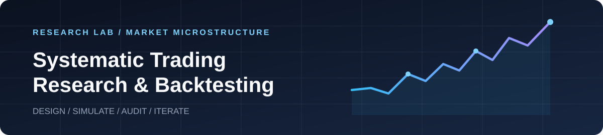

<div align="center">



# Systematic Trading Research & Backtesting

**Reproducible intraday replay and rules-based swing trading experiments.**

[](requirements.txt)
[](docs/METHODOLOGY.md)
[](experiments/README.md)
[](docs/DATA_QUALITY.md)

[**Research overview**](docs/README.md) · [**Experiments**](experiments/README.md) · [**Results**](docs/RESULTS.md) · [**Methods**](docs/METHODOLOGY.md) · [**Caveats**](docs/DATA_QUALITY.md)

</div>

> [!IMPORTANT]
> **Historical simulation, not live trading or audited alpha.** The one-minute replay, the daily swing systems, and the incomplete v2 replay are **different experiments**. Compare results only over the **same dates, universe, cash-flow assumptions, and execution model**. The daily price-only strategies do **not** validate "unexplained" 10% drops or historically cheap valuation multiples.

## At a glance

| Research track | Period | Universe / cadence | Status | Where to start |
|:--|:--|:--|:--|:--|
| **Intraday · original** | Jan–Jun 2025 | Historical minute bars; 1-minute assessment | **Complete** · 122/122 sessions | [Report](results/2025H1/README.md) · [Code](src/) |
| **Intraday · low-turnover v2** | Jan–Jun 2025 requested | 1-minute assessment, lower turnover | **Partial** · 8/122 sessions | [Checkpoint](results/2025H1_v2/README.md) · [Code](experiments/v2_2025H1/) |
| **Swing · 100 liquid names** | 2024–2025 | Daily bars, 100 historical liquidity leaders | **Complete** · 502 sessions | [Experiment](experiments/medium_term_2024_2025/README.md) |
| **Swing · 100 liquid names** | 2020–2025 | Daily bars, 100 historical liquidity leaders | **Complete** · 1,508 sessions | [Experiment](experiments/medium_term_2020_2025/README.md) |
| **Swing · full S&P 500** | 2020–2025 | Daily bars, all *then-current* index members | **Complete** · 1,508 sessions | [Experiment](experiments/medium_term_2020_2025_sp500/README.md) |

### Six-year swing strategy — headline comparison

All accounts begin with **$100,000**. The equity figures below include hypothetical transaction costs and, in some cases, **unverified synthetic M&A settlements**. Source: the committed [machine-readable simulation summaries](docs/RESULTS.md).

| Historical candidate universe | Original exits · end NAV | Original return | Route-aware exits · end NAV | Route-aware return |
|:--|--:|--:|--:|--:|
| **100 by past dollar liquidity** | $124,373.08 | +24.37% | $124,008.34 | +24.01% |
| **All historical S&P 500 members** | $106,429.99 | +6.43% | $124,601.04 | +24.60% |
| **SPY buy and hold** | — | +130.14% | — | +130.14% |

**Reading this correctly:** Original and route-aware are distinct *exit* rules; the route-aware version was revised after inspecting earlier data and is **not a blind out-of-sample result**. The "100" basket is a **historical dollar-volume proxy**, not the 100 largest companies by market capitalization. "All S&P 500" means scanning its roughly 500 contemporaneous constituents, **not holding 500 positions**.


[View annual breakdown, win rates, MDD, and exact raw-file links →](docs/RESULTS.md)

## Repository map

```text
.
├── README.md                           # This project landing page
├── assets/                             # Branding / visuals
├── docs/                               # Cross-experiment research guides
├── experiments/
│   ├── README.md                       # Experiment catalog
│   ├── medium_term_2024_2025/         # Daily; 2 years; liquidity-100
│   ├── medium_term_2020_2025/         # Daily; 6 years; liquidity-100
│   ├── medium_term_2020_2025_sp500/   # Daily; 6 years; dynamic S&P 500
│   └── v2_2025H1/                     # Intraday lower-turnover replay engine
├── results/
│   ├── README.md                       # Intraday results index
│   ├── 2025H1/                         # Original, COMPLETE
│   └── 2025H1_v2/                      # v2, PARTIAL
├── src/                                # Original 1-minute trading engine
├── tests/                              # Intraday tests
└── .github/workflows/                  # Reproducible historical replay jobs
```

## Reproduce an experiment

**Intraday baseline** (minute bars from an external data collection; may require a substantial download):

```bash
python -m pip install -r requirements.txt
python -m unittest discover -s tests -v
python src/batch_replay.py --batch-start 2025-01-01 --batch-end 2025-01-14 --out results/2025H1
```

The intraday runner resumes from a checkpoint; **do not run a first batch into the existing completed result directory**. Use a **fresh output directory** when reproducing an experiment from scratch.

**Daily 2020–2025 full-S&P-500 universe** (both exit rules; downloads historical public price data):

```bash
python -m pip install -r experiments/medium_term_2020_2025_sp500/requirements.txt
python experiments/medium_term_2020_2025_sp500/backtest.py --mode proxy --exit-mode original --out /tmp/sp500_original
python experiments/medium_term_2020_2025_sp500/backtest.py --mode proxy --exit-mode route_aware --out /tmp/sp500_route_aware
```

Experiment READMEs contain their individual inputs, risk rules, paths and replay commands. See the [reproduction guide](docs/METHODOLOGY.md) for assumptions and interpretation.

## Research integrity

- **Data vintage matters.** Historical constituents are reconstructed, but 2026-era price adjustments/corporate-action corrections can remain ex post.
- **Synthetic exit ≠ real fill.** Some acquired/delisted positions were valued using an assumed last available adjusted close, not actual verified merger consideration.
- **Proxy ≠ fundamental test.** P/E, EV/EBITDA, FCF yield, earnings-release timing and contemporaneous news were **not verified** in the automatically executed swing simulations.
- **Missing is not zero.** The intraday v2 checkpoint is **PARTIAL**, with no verified June 2025 result; it must not be annualized or compared as a full six-month return.
- **No cherry-picked headline.** The original 2025H1 intraday replay lost **59.19%**, with approximately **$48,052** modeled transaction costs; its failure and the full postmortem remain prominently documented.

Read [research limitations and evidence standards](docs/DATA_QUALITY.md) before interpreting any P&L number.

---

<div align="center"><sub>Virtual trading only · Source-code and result provenance are retained · Last documentation review: 2026-10-19</sub></div>
