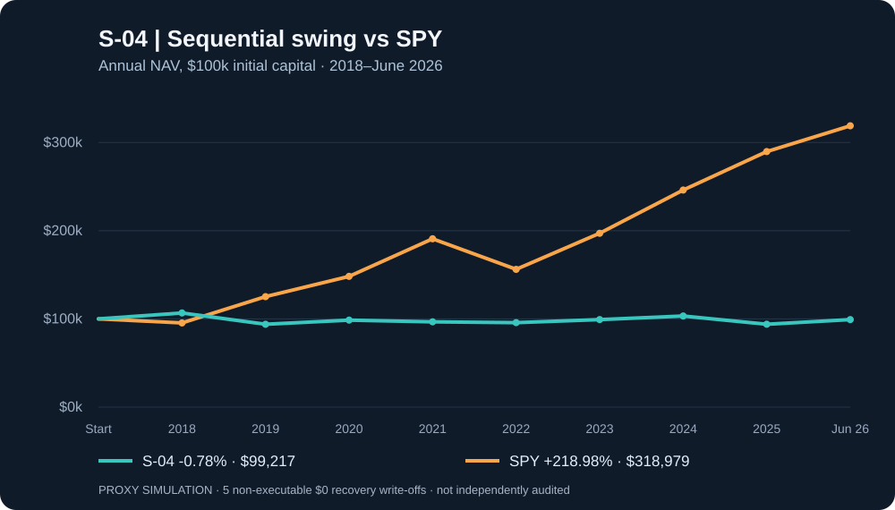

# S-04 · Sequential 2018–2026 swing research

[← Experiment catalog](../README.md) · [Research standards](../../docs/STYLE_GUIDE.md) · [Previous S&P 500 test](../medium_term_2020_2025_sp500/README.md)

> [!IMPORTANT]
> **2018 development → 2019H1 forward → 2019H2 revised → 2020–2025 annual reviews → June 2026 cash-only.** Public adjusted prices and index membership are retrospectively reconstructed. Default PROXY results **do not** validate historical P/E, peer fundamentals or material-news exclusion.

## 01 / Research question

Can a liquid-stock reversal/trend strategy with **+10% take-profit** and **six-calendar-month maximum hold**, where entry profiles are chosen exclusively from prior account observations, outperform dividend-adjusted SPY after costs?

## 02 / Experimental design

| Property | Setting |
|:--|:--|
| Portfolio horizon | 2018-01-02 through 2026-06-30 |
| Development | 2018 (in-sample) |
| First forward-selected profile | 2019H1, selected from 2018 only |
| Second profile review | First July 2019 session, trailing 252 known sessions only |
| Subsequent revisions | First trading session of January 2020–2025, trailing 252 known sessions |
| Stock universe | All then-current S&P 500 members from historical constituent snapshots |
| Opening portfolio | $100,000, long-only, at most 8–10 positions |
| Trade execution | Decision based on prior session's close; fill next session's adjusted open |
| Fees and slippage | 6 basis points per side; fractional shares; zero idle cash interest |
| Risk allocation | Up to 10% NAV per entry, 35–85% gross exposure by profile and SPY regime |
| Last new entry | 2025-12-31 (no 2026 buys) |
| Final disposition | Tradable positions sold June 30, 2026; untradable marked as NON_EXECUTABLE_WRITEOFF |
| Benchmark | SPY total-return adjusted prices, same calendar horizon |

## 03 / Rules

**Liquidity and quality:** price over $5, 63-session average dollar volume at least $20–30m, trailing realized annual volatility under 50–65%, depending on entry profile.

**Reversal:** 5-session decline at least 10–12%, underperforms SPY by 6–9 percentage points, SPY decline less than 6%, recovers 2% from recent low with positive close, RSI14 below profile cutoff and price above 88% of SMA200.

**Trend:** price > SMA20 > SMA50 > SMA200, RSI14 from 47 to 65–70 and price within 8% of a rolling 63-session high.

**Exit order:** a sell order is signaled on prior close when gain is at least **10%**, loss at most **-8%**, peak-close trailing drawdown **-12%**, calendar holding reaches **six months**, or membership ceases. All ordinary exits are executed at the next available open, so gaps can exceed thresholds. Force final dispositions on **June 30, 2026**.

**Adaptive policy:** four immutable profiles (defensive, balanced, trend_bias, reversal_bias) are run as independent shadow portfolios starting 2018. At 2019-01, 2019-07 and each January 2020–2025, rank profiles from their historical **prior** 252 equity observations only:

    score = trailing_return + 0.75 * trailing_max_drawdown - 0.12 * trailing_annualized_volatility

Only **new entries** follow the selected profile; open holdings retain common exits. Thus no 2019H2 observation changes the 2019H1 policy. However, profiles and the ranking objective were designed in 2026: **mechanically sequential replay is not genuinely prospective out-of-sample evidence**.

**Fundamental and peer screening:** only the STRICT mode, with independent timestamped files, checks company P/E, EV/EBITDA, FCF yield, leverage, growth, operating margin and same-sector peer-relative valuations. At least 3 historical peers, 2/3 favourable valuation comparisons, a two-day publication lag and a documented same-day news coverage review are required. No unreviewed decline is called unexplained. Sector peers are proxies, not automatically direct business competitors.

**Corporate actions:** when an exit is untradable and no verified proceeds exist, a conservative $0 write-off is logged separately. It is **not** an executed trade or a verified merger cash payout. An empty final inventory is not proof every position was sold.

## 04 / Results

The verified GitHub Actions workflow finished the price-only proxy replay. **Starting $100,000 → ending $99,216.93 (-0.78%); SPY +218.98%. Five non-executable zero-recovery write-offs materially affect the outcome.** [Full audit report](results/README.md).

Machine-readable sources and audit files:

- [Full JSON summary](results/proxy/summary.json)
- [Daily NAV ledger](results/proxy/equity_curve.csv)
- [Trade log including write-offs](results/proxy/trades.csv)
- [Annual strategy and SPY returns](results/proxy/yearly.csv)
- [Dated policy revision log](results/proxy/policy_log.json)
- [Automated runner](../../.github/workflows/swing-2018-2026-walkforward.yml)

**Fixed-profile comparison:** the permanent reversal-bias profile earned **+19.81%** with zero non-executable write-offs, versus the policy-switching portfolio's **-0.78%** with five write-offs. The difference is confounded by event exposure and cannot identify a causal benefit from holding any profile. [Read the detailed postmortem](RESULTS_ANALYSIS.md).

## 05 / Interpretation

The experiment is independent of S-01 through S-03 and does **not** overwrite their results. Compare only identical dates, capital, exposure, constituents and execution assumptions. The 2026 segment is liquidation-only and not a fresh 2026 entry test.

## 06 / Limitations

Retrospective (2026-built) rule family; split/dividend-adjustment vendor repairs; historical membership revision; unverified corporate-action proceeds; no full historical financial/news input in default mode; sector peers versus true competitors; simplified fixed transaction cost and fractional shares; selection overfit; no real-world auction liquidity or market impact. **No future market prices are read for a decision**, but this alone cannot eliminate all look-ahead and survivorship issues in retroactively assembled datasets.

## 07 / Reproduce

Use Python 3.11 from repository root.

    python -m pip install -r experiments/medium_term_2018_2026_walkforward/requirements.txt
    python -m unittest discover -s experiments/medium_term_2018_2026_walkforward/tests -v
    python experiments/medium_term_2018_2026_walkforward/backtest.py --mode proxy --out experiments/medium_term_2018_2026_walkforward/results/proxy

Downloads ~235MB of price data from the public Johnbrick123/sp500-data GitHub Release, with membership, no-trade and recycled-label files. All downloaded SHA256 checksums are recorded.

For STRICT mode, supply both validated point-in-time CSV files (sample empty-column schemas in the input directory). Fundamentals require ticker, published_at, sector, pe_ttm, ev_ebitda, fcf_yield, net_debt_ebitda, revenue_growth, operating_margin, source_url. News requires ticker, signal_date, reviewed_at, coverage_verified, material_adverse, source_url. Timestamps are UTC, financial percentages are **decimals**, and source_url must be a real dated evidence record. Missing sources must not be replaced with guesses.

    python experiments/medium_term_2018_2026_walkforward/backtest.py --mode strict --fundamentals /path/to/fundamentals_pit.csv --reviews /path/to/news_reviews_pit.csv --out /tmp/strict

## 08 / Evidence checklist

- [x] Decisions evaluated on previous market closes, orders on later opens.
- [x] Profile switches selected from prior shadow-account windows only.
- [x] Point-in-time membership, no-trade-day and ticker-recycling controls.
- [x] No new 2026 buys, mandatory June 2026 disposition accounting.
- [ ] Validate all as-filed financials and true direct business competitors.
- [ ] Validate material-news search coverage and any delisting consideration.
- [ ] Inspect final generated results, policy chronology and data checksums.

[← Experiments](../README.md)
